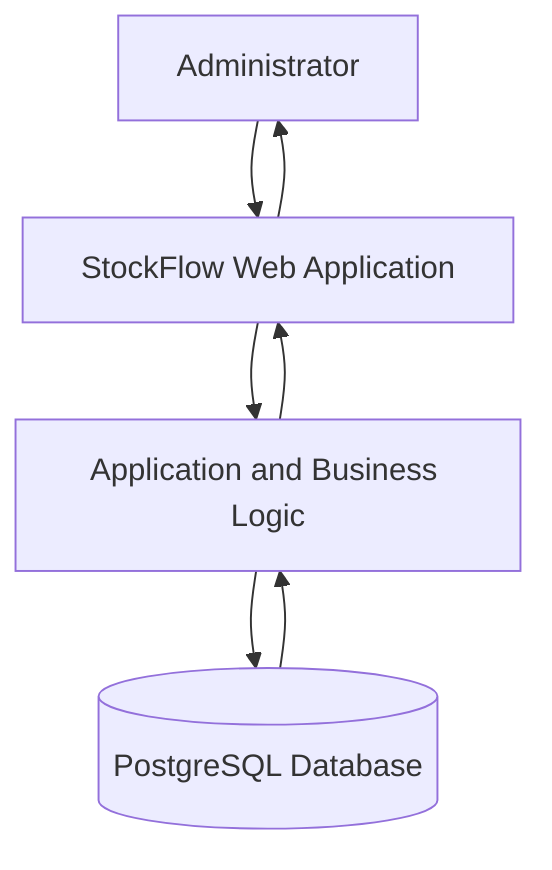
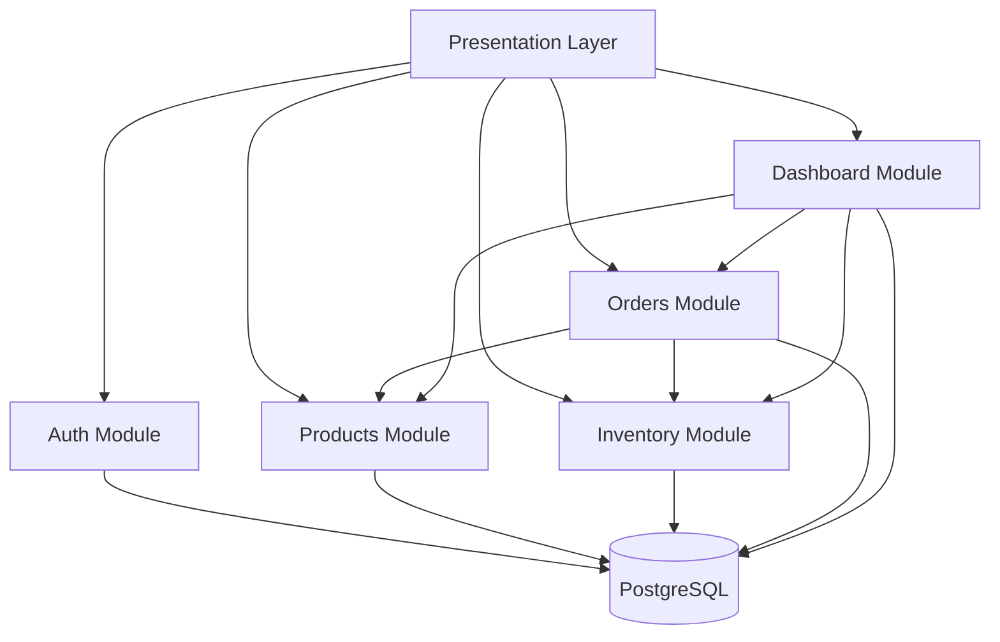

# StockFlow — System Architecture Document

**Document Version:** 1.0
**Status:** Approved
**Project:** StockFlow
**Document Type:** System Architecture

---

## 1. Introduction

### 1.1 Purpose

This document describes the technical architecture of StockFlow, an Inventory and Order Management System.

It defines the system structure, architectural style, application modules, technology responsibilities, data access principles, and communication flow between system components.

This document serves as the technical foundation for implementation.

### 1.2 Architectural Goals

The architecture is designed to achieve the following goals:

- Maintainability: Keep the codebase organized and easy to modify.
- Modularity: Separate business responsibilities into clearly defined modules.
- Data Integrity: Protect inventory and order data from inconsistent operations.
- Testability: Make business logic testable independently from the user interface.
- Security: Protect authentication, authorization, and sensitive operations.
- Scalability: Allow the system to evolve without requiring premature infrastructure complexity.

---

## 2. System Overview

StockFlow is a web-based inventory and order management application.

The system allows an administrator to:

- Authenticate into the application.
- Manage products.
- Monitor and adjust inventory.
- Create and process customer orders.
- Monitor order status and inventory movements.
- View operational information through a dashboard.

### 2.1 System Context

StockFlow consists of three primary technical layers:

1. Presentation Layer: Provides the user interface and receives user input.
2. Application Layer: Handles business rules, validation, authorization, and application workflows.
3. Data Layer: Stores and retrieves persistent application data.

The application communicates with PostgreSQL through Prisma ORM.

### 2.2 System Context Diagram

---

## 3. Architectural Style

### 3.1 Selected Architecture: Modular Monolith

StockFlow adopts a Modular Monolith architecture.

The application is deployed as one primary application but internally divided into modules based on business responsibilities.

Each module owns a specific area of the application and exposes controlled interfaces to other modules.

### 3.2 Rationale

Modular Monolith is selected because:

- StockFlow is initially developed and maintained by one developer.
- The MVP does not require independently deployed services.
- A single application simplifies local development and deployment.
- A single PostgreSQL database simplifies transactional consistency.
- Clear module boundaries support maintainability and future evolution.

### 3.3 Alternatives Considered

**Microservices**

Not selected for the MVP because independently deployed services would introduce additional infrastructure, communication, monitoring, and operational complexity.

**Unstructured Monolith**

Not selected because mixing unrelated business responsibilities would make the application harder to maintain and test.

### 3.4 Architectural Trade-offs

Advantages:

- Simpler deployment and development workflow.
- Easier database transactions across related operations.
- Lower operational complexity.
- Clear internal module boundaries.

Limitations:

- Modules share one deployment lifecycle.
- A failure in the primary application can affect the entire application.
- Module boundaries must be enforced through code organization and development discipline.

---

## 4. Technology Architecture

### 4.1 Technology Stack

| Technology     | Responsibility                        |
| -------------- | ------------------------------------- |
| Next.js        | Web application framework             |
| TypeScript     | Static typing                         |
| PostgreSQL     | Relational database                   |
| Prisma ORM     | Database access and schema management |
| Zod            | Runtime input validation              |
| Vitest         | Unit and integration testing          |
| Playwright     | End-to-end testing                    |
| Git and GitHub | Version control and collaboration     |
| GitHub Actions | Continuous Integration                |

### 4.2 Technology Responsibilities

**Next.js and TypeScript**

Provide the application framework, routing, server-side execution, and typed application code.

**PostgreSQL**

Stores persistent data such as users, products, orders, order items, inventory movements, and order status history.

**Prisma ORM**

Provides typed database access, schema definitions, migrations, and transaction support.

**Zod**

Validates incoming data at runtime. TypeScript types alone are not sufficient to validate untrusted user input.

**Vitest and Playwright**

Support automated testing at different levels, from individual business functions to complete user workflows.

---

## 5. Application Modules

StockFlow is divided into the following logical modules.

### 5.1 Authentication Module

Responsibilities:

- Authenticate administrators.
- Manage authentication sessions.
- Protect application routes and operations.
- Enforce the ADMIN role.

### 5.2 Products Module

Responsibilities:

- Create products.
- View product details and lists.
- Update product information.
- Deactivate products.
- Enforce SKU uniqueness and product validation.

### 5.3 Inventory Module

Responsibilities:

- Maintain product stock quantities.
- Record initial stock movements.
- Process manual stock adjustments.
- Record inventory movements.
- Preserve inventory audit history.

### 5.4 Orders Module

Responsibilities:

- Create pending orders.
- Validate order items.
- Preserve product price snapshots.
- Confirm orders and deduct stock.
- Cancel eligible orders and restore stock.
- Ship confirmed orders.
- Record order status history.
- Enforce idempotency for order creation.

### 5.5 Dashboard Module

Responsibilities:

- Display operational summaries.
- Show product and inventory information.
- Show order statistics.
- Provide an overview of business activity.

The dashboard is a presentation and reporting module. It must not bypass the business rules owned by the Products, Inventory, and Orders modules.

---

## 6. Module Dependency Principles

The following principles govern communication between modules:

1. Modules must have clearly defined responsibilities.
2. Business rules must be implemented in the application layer, not duplicated across user interface components.
3. Modules should interact through explicit application interfaces.
4. Modules must not directly modify another module's data in ways that bypass its business rules.
5. Shared infrastructure, such as database access and logging, may be used by multiple modules.
6. Cross-module operations requiring atomicity must use a coordinated database transaction.
7. The application service coordinating a cross-module operation owns the database transaction.
8. Participating modules must receive and use the transaction context provided by the coordinator.
9. A participating module must not independently commit or roll back a transaction owned by another module.

### 6.1 High-Level Module Relationships

The diagram describes logical relationships, not permission for arbitrary direct database access. Cross-module operations must follow the defined application interfaces and transaction boundaries.

---

## 7. Data Architecture Principles

### 7.1 Relational Data Model

StockFlow uses PostgreSQL as its primary relational database.

The main entities include:

- User
- Product
- Order
- OrderItem
- StockMovement
- OrderStatusHistory
- IdempotencyRecord

Detailed attributes, relationships, constraints, and indexes are defined in the Database Design Document.

### 7.2 Data Integrity

The following principles must be enforced:

- Product SKU must be unique.
- Product price and stock must not be negative.
- Order quantities must be positive.
- Inventory must never become negative.
- Order items must retain their original price snapshot.
- Stock movements must be recorded for stock changes.
- Order status changes must be recorded in status history.
- Stock changes and related order status changes must be atomic when required.

### 7.3 Transaction Management

Operations that modify multiple related records must use database transactions.

Examples include:

- Confirming an order and deducting stock.
- Cancelling a confirmed order and restoring stock.
- Performing a manual stock adjustment and recording its movement.
- Creating an order and persisting its idempotency result.

If an operation fails, all changes within its transaction must be rolled back.

Concurrency controls must prevent overselling, negative inventory, and duplicate processing.

### 7.4 Transaction Ownership and Propagation

The application service initiating a cross-module business operation is responsible for coordinating its database transaction.

For order confirmation and cancellation:

- The Orders Application Service owns the transaction.
- The Inventory Service receives the transaction context from the Orders Application Service.
- Inventory operations execute within the caller's transaction.
- The Inventory Service must not independently commit or roll back the caller's transaction.

For manual inventory adjustments, the Inventory Application Service owns the transaction.

This approach ensures that related changes across modules remain atomic while preserving module responsibilities.

---

## 8. Security Architecture

StockFlow applies the following security principles:

- Authentication is required for protected application functionality.
- Only users with the ADMIN role may access administrative operations.
- Authorization must be enforced on the server side.
- Incoming data must be validated before business processing.
- Database credentials must be stored in environment variables.
- Secrets must not be committed to Git.
- Passwords must be stored using secure password hashing if password-based authentication is implemented.
- Production communication must use HTTPS.
- Database access must follow the principle of least privilege.

---

## 9. Deployment Architecture

### 9.1 Deployment Model

StockFlow is designed for cloud deployment.

The planned deployment components are:

- Next.js application hosted on a cloud application platform.
- PostgreSQL hosted by a managed database provider.
- Environment variables for deployment-specific configuration.
- GitHub Actions for automated quality checks.

### 9.2 Deployment Environments

The project uses three logical environments:

**Development**

Used for local development and testing.

**Testing**

Used for automated checks and pre-release verification.

**Production**

Used by the deployed application and contains production data.

Environment-specific configuration and database credentials must remain separate.

The final hosting provider and production configuration will be confirmed during the deployment phase.

---

## 10. Testing Architecture

Testing is performed at multiple levels:

### 10.1 Unit Testing

Tests isolated business logic, validation functions, and utility functions.

### 10.2 Integration Testing

Tests interactions between application services and the database.

Important scenarios include:

- Order confirmation with sufficient stock.
- Order confirmation with insufficient stock.
- Atomic rollback when confirmation fails.
- Concurrent order confirmation.
- Cancellation and stock restoration.
- Manual stock adjustment.
- Idempotent order creation.

### 10.3 End-to-End Testing

Tests complete user workflows through the application interface.

Examples include:

- Administrator login.
- Product creation and update.
- Inventory adjustment.
- Order creation and confirmation.
- Order cancellation and shipment.

---

## 11. Architectural Constraints

The following constraints apply to the MVP:

1. The system uses a single primary Next.js application.
2. PostgreSQL is the primary relational database.
3. The MVP uses one administrative role.
4. The application follows a Modular Monolith architecture.
5. Inventory changes must be auditable.
6. Order and inventory operations must preserve transactional consistency.
7. Microservices are not part of the initial implementation.

---

## 12. Future Architectural Considerations

The architecture may evolve when business requirements justify additional complexity.

Potential future improvements include:

- Additional user roles and permission levels.
- Background job processing.
- Notification services.
- External integrations.
- Read replicas for database scaling.
- Separately deployed services for modules with independent scaling needs.

These improvements are outside the current MVP scope.

---

## 13. Architecture Decisions Summary

| Decision            | Selected Approach     | Reason                                |
| ------------------- | --------------------- | ------------------------------------- |
| Architectural style | Modular Monolith      | Simplicity and maintainability        |
| Web framework       | Next.js               | Full-stack application framework      |
| Language            | TypeScript            | Static type safety                    |
| Database            | PostgreSQL            | Relational integrity and transactions |
| ORM                 | Prisma                | Typed database access                 |
| Validation          | Zod                   | Runtime validation                    |
| Testing             | Vitest and Playwright | Multiple testing levels               |
| Deployment          | Cloud hosting         | Production accessibility              |

---

## 14. References

- Software Requirements Specification: `docs/requirements/srs.md`
- Database Design: `docs/database/database-design.md`
- API Contract: `docs/api/api-contract.md`
- Testing Strategy: `docs/testing/testing-strategy.md`

---

**End of Document**
