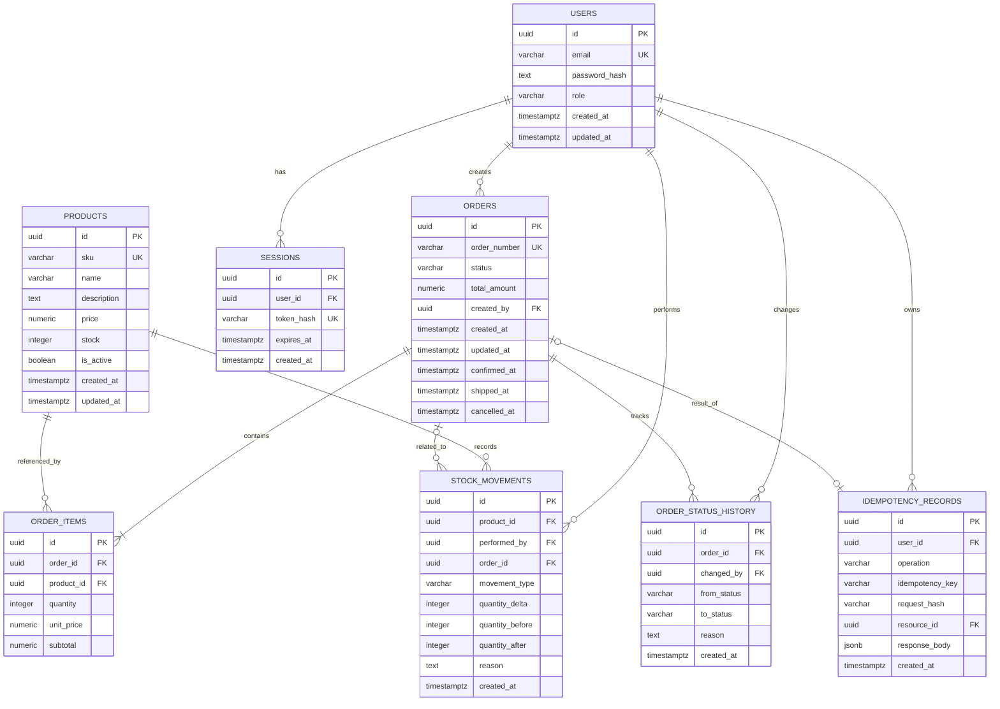

# StockFlow — Database Design Document

**Document Version:** 1.0
**Status:** Approved
**Project:** StockFlow
**Document Type:** Database Design

---

# 1. Introduction

## 1.1 Purpose

This document defines the database design for StockFlow, an Inventory and Order Management System.

It describes the database entities, attributes, relationships, constraints, indexes, and transaction principles required to maintain data integrity and support application functionality.

This document serves as the technical reference for implementing the PostgreSQL database schema using Prisma ORM.

## 1.2 Database Objectives

The database design aims to:

- Maintain reliable and consistent inventory data.
- Preserve order and transaction history.
- Prevent negative inventory quantities.
- Support atomic order and inventory operations.
- Maintain auditable stock movements.
- Prevent duplicate order creation through idempotency.
- Support efficient data retrieval.
- Preserve historical business records.

## 1.3 Database Technology

| Component     | Technology    |
| ------------- | ------------- |
| Database      | PostgreSQL    |
| ORM           | Prisma        |
| Primary Key   | UUID          |
| Monetary Data | NUMERIC(15,2) |
| Timestamp     | TIMESTAMPTZ   |
| JSON Data     | JSONB         |

---

# 2. Database Design Principles

The database follows these principles:

1. Relational data modeling.
2. UUID primary keys.
3. Referential integrity through foreign keys.
4. Explicit constraints for business-critical data.
5. Transactional consistency for inventory and order operations.
6. Immutable audit records through normal application workflows.
7. Controlled deletion using RESTRICT.
8. Indexing for frequently accessed data.
9. Separation between current inventory balance and inventory movement history.

## 2.1 Primary Key Strategy

All primary keys use UUID.

Example:

`550e8400-e29b-41d4-a716-446655440000`

UUID provides globally unique identifiers without relying on sequential numeric IDs.

## 2.2 Monetary Data Strategy

All monetary values use PostgreSQL `NUMERIC(15,2)`.

Floating-point types must not be used for financial calculations because they may introduce precision errors.

The application must use decimal-safe calculations when processing monetary values.

## 2.3 Deletion Strategy

Foreign key relationships use RESTRICT to protect historical data.

Products and users are not physically deleted through normal application workflows when referenced by business records.

Products that are no longer available must be deactivated instead.

---

# 3. Entity Overview

StockFlow uses eight primary database tables:

| Entity               | Description                                       |
| -------------------- | ------------------------------------------------- |
| users                | Stores administrator accounts                     |
| products             | Stores product information and current stock      |
| orders               | Stores order header information                   |
| order_items          | Stores individual order items and price snapshots |
| stock_movements      | Stores inventory movement history                 |
| order_status_history | Stores order status transitions                   |
| idempotency_records  | Stores idempotency keys and operation results     |
| sessions             | Stores hashed administrator session tokens        |

## 3.1 Entity Relationship Diagram

Note: The diagram describes logical relationships. The optional relationship between an order and its idempotency record is enforced through the `resource_id` foreign key. The exact cardinality is governed by the unique constraints.

---

# 4. Table Specifications

## 4.1 Users

Table name: `users`

Purpose: Stores administrator authentication and account information.

| Column        | Data Type    | Constraints               |
| ------------- | ------------ | ------------------------- |
| id            | UUID         | Primary Key               |
| email         | VARCHAR(255) | NOT NULL, UNIQUE          |
| password_hash | TEXT         | NOT NULL                  |
| role          | VARCHAR(20)  | NOT NULL, DEFAULT 'ADMIN' |
| created_at    | TIMESTAMPTZ  | NOT NULL                  |
| updated_at    | TIMESTAMPTZ  | NOT NULL                  |

### Business Rules

- Email must be unique.
- Password must be stored as a secure password hash.
- The MVP supports the ADMIN role only.
- Role authorization must be enforced by the application.
- Referenced users cannot be physically deleted through normal application workflows.

## 4.2 Sessions

Table name: `sessions`

Purpose: Stores active administrator sessions for server-side validation and revocation.

| Column     | Data Type    | Constraints           |
| ---------- | ------------ | --------------------- |
| id         | UUID         | Primary Key           |
| user_id    | UUID         | NOT NULL, FK users.id |
| token_hash | VARCHAR(255) | NOT NULL, UNIQUE      |
| expires_at | TIMESTAMPTZ  | NOT NULL              |
| created_at | TIMESTAMPTZ  | NOT NULL              |

### Session Rules

- Store only a cryptographic hash of the session token; send the raw token only in the session cookie.
- Sessions expire 12 hours after creation; expiration is fixed and is not extended by activity.
- Logout revokes the current session immediately by deleting its record.
- After successful login, delete expired session records.
- Do not delete unexpired sessions during expired-session cleanup.
- Session cookies must use HttpOnly, Secure in production, and SameSite protection.

## 4.3 Products

Table name: `products`

Purpose: Stores product information and current inventory balance.

| Column      | Data Type     | Constraints                     |
| ----------- | ------------- | ------------------------------- |
| id          | UUID          | Primary Key                     |
| sku         | VARCHAR(100)  | NOT NULL, UNIQUE                |
| name        | VARCHAR(255)  | NOT NULL                        |
| description | TEXT          | NULL                            |
| price       | NUMERIC(15,2) | NOT NULL, CHECK >= 0            |
| stock       | INTEGER       | NOT NULL, DEFAULT 0, CHECK >= 0 |
| is_active   | BOOLEAN       | NOT NULL, DEFAULT TRUE          |
| created_at  | TIMESTAMPTZ   | NOT NULL                        |
| updated_at  | TIMESTAMPTZ   | NOT NULL                        |

### Business Rules

- SKU must be unique.
- Product price cannot be negative.
- Stock cannot be negative.
- New products may start with zero stock.
- Initial stock greater than zero must generate an INITIAL_STOCK movement.
- Inactive products cannot be included in new orders.
- Inactive products cannot be used to confirm pending orders.
- Inactive products can remain associated with historical orders.
- Manual stock adjustments are allowed for inactive products.
- Products must be deactivated rather than physically deleted when historical references exist.

### Inventory Balance Principle

`products.stock` stores the current operational inventory balance.

It must be updated in the same database transaction as the corresponding stock movement.

## 4.4 Orders

Table name: `orders`

Purpose: Stores the main information of customer orders.

| Column       | Data Type     | Constraints           |
| ------------ | ------------- | --------------------- |
| id           | UUID          | Primary Key           |
| order_number | VARCHAR(50)   | NOT NULL, UNIQUE      |
| status       | VARCHAR(20)   | NOT NULL              |
| total_amount | NUMERIC(15,2) | NOT NULL, CHECK >= 0  |
| created_by   | UUID          | NOT NULL, FK users.id |
| created_at   | TIMESTAMPTZ   | NOT NULL              |
| updated_at   | TIMESTAMPTZ   | NOT NULL              |
| confirmed_at | TIMESTAMPTZ   | NULL                  |
| shipped_at   | TIMESTAMPTZ   | NULL                  |
| cancelled_at | TIMESTAMPTZ   | NULL                  |

### Allowed Status Values

- PENDING
- CONFIRMED
- SHIPPED
- CANCELLED

### Status Rules

| Current Status | Allowed Next Status |
| -------------- | ------------------- |
| PENDING        | CONFIRMED           |
| PENDING        | CANCELLED           |
| CONFIRMED      | SHIPPED             |
| CONFIRMED      | CANCELLED           |
| SHIPPED        | None                |
| CANCELLED      | None                |

### Business Rules

- New orders must start with PENDING status.
- Order numbers use the format `ORD-YYYY-000001`, where `YYYY` is the UTC calendar year of order creation and the sequence is global and does not reset annually.
- Order numbers must be generated from a PostgreSQL sequence to ensure uniqueness under concurrent order creation. Sequence values are not reused; gaps may occur when a transaction fails.
- Creating an order does not deduct stock.
- Stock is deducted only when an order is confirmed.
- Order confirmation must validate current stock and product activity.
- Confirmed orders may be cancelled before shipment.
- Cancelling a confirmed order restores stock.
- Shipped orders cannot be cancelled through the normal MVP workflow.
- Order status transitions must be recorded in order_status_history.
- All order operations must follow the defined transaction rules.

## 4.5 Order Items

Table name: `order_items`

Purpose: Stores product details belonging to an order.

| Column     | Data Type     | Constraints              |
| ---------- | ------------- | ------------------------ |
| id         | UUID          | Primary Key              |
| order_id   | UUID          | NOT NULL, FK orders.id   |
| product_id | UUID          | NOT NULL, FK products.id |
| quantity   | INTEGER       | NOT NULL, CHECK > 0      |
| unit_price | NUMERIC(15,2) | NOT NULL, CHECK >= 0     |
| subtotal   | NUMERIC(15,2) | NOT NULL, CHECK >= 0     |

### Constraints

Unique constraint:

`UNIQUE(order_id, product_id)`

This ensures that one product appears only once in an order.

Duplicate product IDs received in a creation request must be consolidated by summing their quantities before persistence.

### Price Snapshot

`unit_price` stores the product price at order creation time.

Changes to the current product price must not change existing order item prices.

### Subtotal Calculation

`subtotal = quantity × unit_price`

The application must calculate and validate the subtotal using decimal-safe arithmetic.

The order total is the sum of all order item subtotals.

Order items are historical transaction details and must not be modified through normal application workflows after order creation.

## 4.6 Stock Movements

Table name: `stock_movements`

Purpose: Records all inventory quantity changes.

| Column          | Data Type   | Constraints              |
| --------------- | ----------- | ------------------------ |
| id              | UUID        | Primary Key              |
| product_id      | UUID        | NOT NULL, FK products.id |
| performed_by    | UUID        | NOT NULL, FK users.id    |
| order_id        | UUID        | NULL, FK orders.id       |
| movement_type   | VARCHAR(30) | NOT NULL                 |
| quantity_delta  | INTEGER     | NOT NULL, CHECK <> 0     |
| quantity_before | INTEGER     | NOT NULL, CHECK >= 0     |
| quantity_after  | INTEGER     | NOT NULL, CHECK >= 0     |
| reason          | TEXT        | NULL                     |
| created_at      | TIMESTAMPTZ | NOT NULL                 |

### Movement Types

| Movement Type   | Quantity Direction | Description                          |
| --------------- | ------------------ | ------------------------------------ |
| INITIAL_STOCK   | Positive           | Initial product stock                |
| ORDER_CONFIRMED | Negative           | Stock deduction after confirmation   |
| ORDER_CANCELLED | Positive           | Stock restoration after cancellation |
| ADJUSTMENT_IN   | Positive           | Manual stock increase                |
| ADJUSTMENT_OUT  | Negative           | Manual stock decrease                |

### Movement Rules

- Every stock change must generate a movement record.
- Quantity delta must not be zero.
- Quantity after must equal quantity before plus quantity delta.
- Quantity after cannot be negative.
- INITIAL_STOCK must be positive.
- ORDER_CONFIRMED must be negative.
- ORDER_CANCELLED must be positive.
- ADJUSTMENT_IN must be positive.
- ADJUSTMENT_OUT must be negative.
- Manual adjustment requires a non-empty reason.
- Initial stock of zero does not require a movement record.
- Order-related movements must reference their corresponding order.
- Stock movement records are immutable through normal application workflows.

### Inventory Consistency

The following equation must always hold for each movement:

`quantity_after = quantity_before + quantity_delta`

The application must update `products.stock` and insert the corresponding stock movement within the same transaction.

## 4.7 Order Status History

Table name: `order_status_history`

Purpose: Maintains a historical record of order status transitions.

| Column      | Data Type   | Constraints            |
| ----------- | ----------- | ---------------------- |
| id          | UUID        | Primary Key            |
| order_id    | UUID        | NOT NULL, FK orders.id |
| changed_by  | UUID        | NOT NULL, FK users.id  |
| from_status | VARCHAR(20) | NULL                   |
| to_status   | VARCHAR(20) | NOT NULL               |
| reason      | TEXT        | NULL                   |
| created_at  | TIMESTAMPTZ | NOT NULL               |

### Rules

- Every order must have an initial history record.
- Initial status uses NULL as from_status and PENDING as to_status.
- Every subsequent status transition must generate a history record.
- Status history must follow the allowed order state transitions.
- Cancellation transitions from PENDING or CONFIRMED must record a non-empty reason.
- History records cannot be edited or deleted through normal application workflows.

## 4.8 Idempotency Records

Table name: `idempotency_records`

Purpose: Prevents duplicate order creation when a request is repeated.

| Column          | Data Type    | Constraints                    |
| --------------- | ------------ | ------------------------------ |
| id              | UUID         | Primary Key                    |
| user_id         | UUID         | NOT NULL, FK users.id          |
| operation       | VARCHAR(50)  | NOT NULL                       |
| idempotency_key | VARCHAR(255) | NOT NULL                       |
| request_hash    | VARCHAR(64)  | NOT NULL                       |
| resource_id     | UUID         | NOT NULL, UNIQUE, FK orders.id |
| response_body   | JSONB        | NULL                           |
| created_at      | TIMESTAMPTZ  | NOT NULL                       |

### Unique Constraint

`UNIQUE(user_id, operation, idempotency_key)`

### Idempotency Rules

- The same key and same payload must return the original operation result.
- The same key with a different payload must return a conflict.
- Idempotency keys are scoped to the user and operation.
- Idempotency records must be persisted atomically with the order creation result.
- Concurrent requests using the same key must not create duplicate orders.
- The resource_id references the order created by the operation.
- Every committed idempotency record must reference an existing order.
- Each order can be referenced by at most one idempotency record.

The retention policy for idempotency records must be defined before implementing cleanup mechanisms. Records must not be removed while their retention is required to guarantee the intended idempotency behavior.

---

# 5. Relationships and Referential Integrity

## 5.1 Relationship Summary

| Parent   | Child                | Relationship              |
| -------- | -------------------- | ------------------------- |
| users    | orders               | One-to-Many               |
| users    | stock_movements      | One-to-Many               |
| users    | order_status_history | One-to-Many               |
| users    | idempotency_records  | One-to-Many               |
| users    | sessions             | One-to-Many               |
| orders   | order_items          | One-to-Many               |
| products | order_items          | One-to-Many               |
| products | stock_movements      | One-to-Many               |
| orders   | stock_movements      | One-to-Many, optional     |
| orders   | order_status_history | One-to-Many               |
| orders   | idempotency_records  | Optional result reference |

## 5.2 Foreign Key Deletion Behavior

Foreign keys must use RESTRICT deletion behavior.

This prevents accidental removal of historical business data.

Examples:

- A product referenced by an order item cannot be physically deleted.
- A user referenced by an order cannot be physically deleted.
- An order referenced by stock movements cannot be physically deleted.
- Historical audit records cannot be removed through normal application workflows.

---

## 5.3 Referential Integrity

All foreign keys must reference existing records.

Foreign key deletion behavior must protect historical business records through RESTRICT.

---

# 6. Database Constraints

The following constraints must be implemented at the database level whenever possible.

## 6.1 Primary Key Constraints

All eight tables must have UUID primary keys.

## 6.2 Unique Constraints

| Table               | Unique Constraint                     |
| ------------------- | ------------------------------------- |
| users               | email                                 |
| products            | sku                                   |
| orders              | order_number                          |
| order_items         | order_id + product_id                 |
| idempotency_records | user_id + operation + idempotency_key |
| sessions            | token_hash                            |
| stock_movements     | order_id + product_id + movement_type |

## 6.3 Check Constraints

| Table           | Constraint                                                  |
| --------------- | ----------------------------------------------------------- |
| products        | price >= 0                                                  |
| products        | stock >= 0                                                  |
| orders          | total_amount >= 0                                           |
| orders          | status belongs to allowed values                            |
| order_items     | quantity > 0                                                |
| order_items     | unit_price >= 0                                             |
| order_items     | subtotal >= 0                                               |
| stock_movements | quantity_delta <> 0                                         |
| stock_movements | quantity_before >= 0                                        |
| stock_movements | quantity_after >= 0                                         |
| stock_movements | quantity_after = quantity_before + quantity_delta           |
| stock_movements | INITIAL_STOCK must have positive quantity_delta             |
| stock_movements | ORDER_CONFIRMED must have negative quantity_delta           |
| stock_movements | ORDER_CANCELLED must have positive quantity_delta           |
| stock_movements | ADJUSTMENT_IN must have positive quantity_delta             |
| stock_movements | ADJUSTMENT_OUT must have negative quantity_delta            |
| stock_movements | ADJUSTMENT_IN and ADJUSTMENT_OUT require a non-empty reason |

Additional movement type and direction constraints should ensure that movement types use the correct sign.

Reason requirements for manual adjustments must also be validated by the application and enforced at the database level where practical.

# 7. Index Strategy

Indexes are designed around frequently used queries.

| Table                | Index                                       | Purpose                         |
| -------------------- | ------------------------------------------- | ------------------------------- |
| users                | UNIQUE(email)                               | Authentication lookup           |
| products             | UNIQUE(sku)                                 | Product lookup                  |
| products             | INDEX(is_active)                            | Active product filtering        |
| products             | INDEX(name)                                 | Product search support          |
| orders               | UNIQUE(order_number)                        | Order lookup                    |
| orders               | INDEX(status, created_at)                   | Order filtering and listing     |
| orders               | INDEX(created_by, created_at)               | Administrator order history     |
| order_items          | UNIQUE(order_id, product_id)                | Prevent duplicate product items |
| order_items          | INDEX(product_id)                           | Product order history           |
| stock_movements      | INDEX(product_id, created_at)               | Inventory movement history      |
| stock_movements      | INDEX(order_id)                             | Order-related stock movements   |
| stock_movements      | INDEX(performed_by, created_at)             | Administrator activity          |
| order_status_history | INDEX(order_id, created_at)                 | Order status history            |
| idempotency_records  | UNIQUE(user_id, operation, idempotency_key) | Idempotency enforcement         |
| idempotency_records  | INDEX(resource_id)                          | Operation result lookup         |
| sessions             | UNIQUE(token_hash)                          | Session lookup                  |
| sessions             | INDEX(expires_at)                           | Expired session cleanup         |

Indexes must be evaluated against actual query patterns. Additional indexes should not be created without considering their write overhead.

---

# 8. Transaction Management

## 8.1 General Principle

Operations that modify multiple related records must execute within database transactions.

A transaction must either complete all required changes or roll back all of them.

## 8.2 Order Creation

Order creation must:

1. Validate the incoming request.
2. Consolidate duplicate product IDs.
3. Validate product existence and activity.
4. Capture current product prices.
5. Calculate order item subtotals and order total.
6. Obtain the next value from the global PostgreSQL order number sequence and format it as `ORD-YYYY-000001`, using the UTC calendar year of order creation.
7. Create the order with PENDING status and the generated order number.
8. Create order items.
9. Create the initial order status history record.
10. Persist the idempotency result.
11. Commit the transaction.

Order creation must not deduct stock.

## 8.3 Order Confirmation

The Orders Application Service owns the transaction.

The operation must:

1. Start a database transaction.
2. Verify the order is PENDING.
3. Retrieve and validate order items.
4. Verify that all products are active.
5. Verify the latest stock quantities.
6. Deduct stock using concurrency-safe database operations.
7. Create ORDER_CONFIRMED stock movement records.
8. Update the order status to CONFIRMED.
9. Record the order status transition.
10. Commit the transaction.

If any step fails, all changes must be rolled back.

## 8.4 Order Cancellation

For PENDING orders:

- Update status to CANCELLED.
- Create an order status history record.
- Do not modify inventory.

For CONFIRMED orders:

- Start a database transaction.
- Verify the order is eligible for cancellation.
- Restore stock quantities.
- Create ORDER_CANCELLED movement records.
- Update the order status to CANCELLED.
- Create the corresponding status history record.
- Commit the transaction.

SHIPPED orders cannot be cancelled through the normal MVP workflow.

## 8.5 Manual Stock Adjustment

The Inventory Application Service owns the transaction.

The operation must:

1. Validate the requested adjustment and product existence; product activity status does not restrict adjustments.
2. Require a non-empty reason.
3. Read the latest stock quantity safely.
4. Calculate the new stock quantity.
5. Reject any operation that would result in negative stock.
6. Update products.stock.
7. Insert the appropriate adjustment movement.
8. Commit the transaction.

## 8.6 Transaction Ownership and Propagation

The application service initiating a cross-module business operation owns the transaction.

For order confirmation and cancellation:

- Orders Application Service owns the transaction.
- Inventory Service receives the transaction context.
- Inventory operations execute within the caller's transaction.
- Inventory Service must not independently commit or roll back the caller's transaction.

For manual stock adjustments:

- Inventory Application Service owns the transaction.
- All stock updates and movement records execute within that transaction.

This approach preserves atomicity while maintaining clear module responsibilities.

---

# 9. Concurrency and Inventory Consistency

Inventory operations must prevent race conditions and negative stock.

## 9.1 Concurrency Risks

Example:

A product has 10 units in stock.

Two administrators or concurrent requests attempt to confirm orders requiring 7 units each.

Without concurrency control, both operations might read stock as 10 and incorrectly deduct 7 units.

The resulting stock could become negative.

## 9.2 Required Protection

The implementation must use database-level concurrency controls.

Possible approaches include:

- Conditional atomic updates.
- Row-level locking.
- Serializable transaction isolation where justified.

For StockFlow, conditional stock updates and appropriate row locking are suitable implementation approaches.

The operation must verify that sufficient stock remains at the time of the update.

## 9.3 Multi-Product Orders

When an order contains multiple products:

- Product rows should be locked or updated in a deterministic order.
- All required stock deductions must occur within one transaction.
- If any product has insufficient stock, the entire operation must roll back.

This prevents partial order confirmation.

---

# 10. Audit and Historical Data

## 10.1 Stock Movement Audit

Every stock change must have a corresponding stock movement record.

The record includes:

- Product reference.
- User responsible for the operation.
- Movement type.
- Quantity change.
- Quantity before.
- Quantity after.
- Reason when required.
- Related order when applicable.
- Timestamp.

## 10.2 Order Status Audit

Every order status transition must create an order status history record.

The record includes:

- Order reference.
- Previous status.
- New status.
- User responsible.
- Reason when applicable.
- Timestamp.

## 10.3 Immutability

Stock movement and order status history records must be immutable through normal application workflows.

Corrections must be represented through new records rather than editing or deleting historical records.

Database permissions and application-level access must support this principle.

Database permissions and application-level controls must prevent normal application operations from updating or deleting historical stock movement and order status history records.

Privileged database maintenance operations must be controlled and audited separately.

---

# 11. Data Integrity and Business Rule Mapping

| Business Rule              | Database Support                         |
| -------------------------- | ---------------------------------------- |
| Unique product SKU         | UNIQUE constraint                        |
| Nonnegative product price  | CHECK constraint                         |
| Nonnegative stock          | CHECK constraint                         |
| Positive order quantity    | CHECK constraint                         |
| Unique product per order   | Composite UNIQUE constraint              |
| Price snapshot             | order_items.unit_price                   |
| Stock change audit         | stock_movements                          |
| Order status audit         | order_status_history                     |
| Idempotent order creation  | Unique idempotency key scope             |
| Prevent negative stock     | CHECK constraint and concurrency control |
| Protect historical records | Foreign keys with RESTRICT               |
| Atomic stock deduction     | Database transaction                     |
| Atomic stock restoration   | Database transaction                     |

---

# 12. Migration and Schema Management

Prisma ORM is used to manage database schema definitions and migrations.

The following principles apply:

- Database schema changes must be represented through Prisma migrations.
- Migrations must be version-controlled.
- Production schema changes must be applied through controlled deployment procedures.
- Existing historical data must be considered before modifying or removing columns.
- Destructive migrations must be reviewed before execution.
- Database schema and Prisma models must remain consistent.

---

# 13. Testing Requirements

Database behavior must be validated through automated tests.

Important scenarios include:

## 13.1 Product Tests

- Create product with valid data.
- Reject duplicate SKU.
- Reject negative price.
- Reject negative stock.
- Deactivate product.

## 13.2 Order Tests

- Create order with valid items.
- Consolidate duplicate product IDs.
- Preserve product price snapshot.
- Reject invalid quantity.
- Reject inactive products.
- Verify initial PENDING status.

## 13.3 Inventory Tests

- Record initial stock.
- Deduct stock during confirmation.
- Restore stock during cancellation.
- Perform manual stock adjustments.
- Reject adjustments resulting in negative stock.
- Verify stock movement history.

## 13.4 Transaction Tests

- Verify rollback when confirmation fails.
- Verify rollback when one product has insufficient stock.
- Verify atomic cancellation and stock restoration.
- Verify concurrent confirmations do not oversell.
- Verify idempotency prevents duplicate order creation.

## 13.5 Audit Tests

- Verify stock movements are generated.
- Verify order status history is generated.
- Verify historical records cannot be modified or deleted through normal application workflows.

---

# 14. Future Considerations

The following improvements are outside the current MVP scope:

- Multi-warehouse inventory.
- Product variants.
- Supplier management.
- Purchase orders.
- Inventory reservation.
- Advanced stock reconciliation.
- Soft deletion policies for additional entities.
- Expanded user roles and permissions.
- Database read replicas.
- Advanced audit reporting.

These improvements must be evaluated against future business requirements before implementation.

---

# 15. Database Design Decisions Summary

| Area                   | Decision                                  |
| ---------------------- | ----------------------------------------- |
| Database               | PostgreSQL                                |
| ORM                    | Prisma                                    |
| Primary Key            | UUID                                      |
| Monetary Data          | NUMERIC(15,2)                             |
| Timestamp              | TIMESTAMPTZ                               |
| JSON Data              | JSONB                                     |
| Referential Integrity  | Foreign Keys                              |
| Deletion Policy        | RESTRICT                                  |
| Inventory Balance      | products.stock                            |
| Inventory History      | stock_movements                           |
| Order History          | order_status_history                      |
| Idempotency            | idempotency_records                       |
| Authentication Session | PostgreSQL sessions with hashed tokens    |
| Transaction Strategy   | Atomic database transactions              |
| Concurrency Control    | Conditional updates and row-level locking |
| Audit Strategy         | Immutable historical records              |

---

# 16. References

- Software Requirements Specification: `docs/requirements/srs.md`
- System Architecture: `docs/architecture/architecture.md`
- API Contract: `docs/api/api-contract.md`
- Testing Strategy: `docs/testing/testing-strategy.md`

---

**End of Document**
